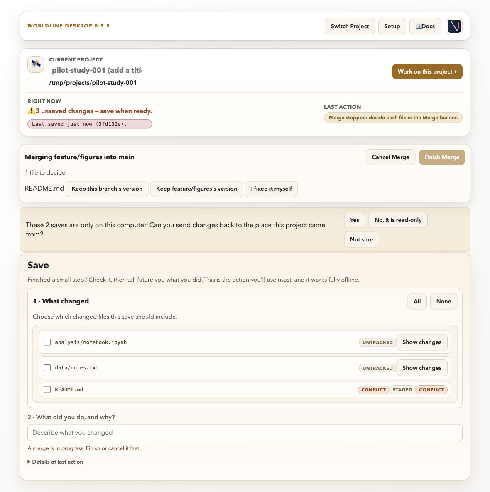
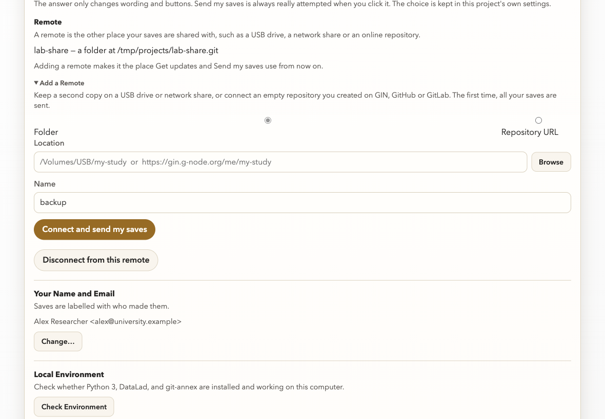
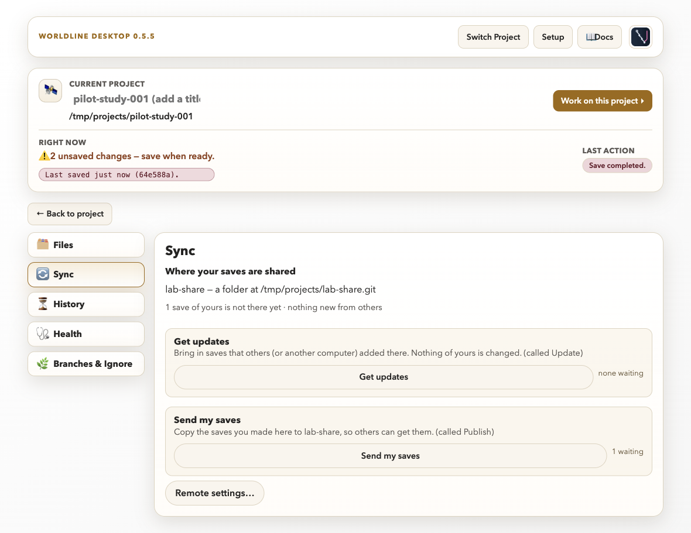
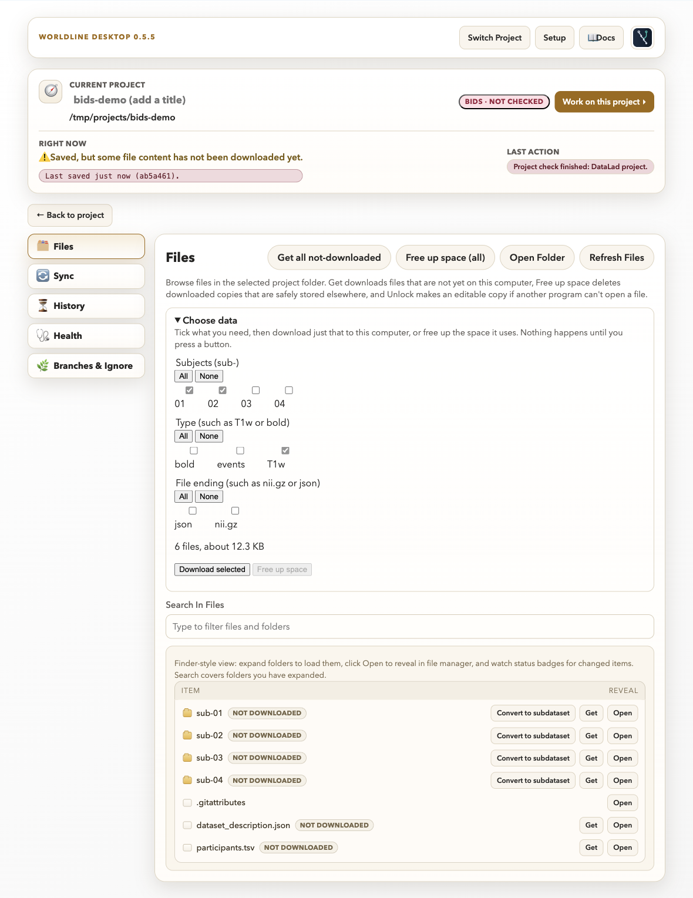

# Tutorial 4: Multi-modal project integration

## Scenario

A study combines imaging, clinical, and survey data. Work is split by modality
and then integrated for a unified analysis save.

**Level:** Intermediate to advanced · **Time:** 60 to 75 minutes

## Skills trained

- Manage complex projects with modality-specific components
- Track changes across nested structures
- Integrate parallel branches into a dedicated integration branch
- Validate project state before Send my saves
- Download only the data you need from a large project

## Setup

1. Create branches:
   - `feature/imaging-qc`
   - `feature/clinical-harmonization`
   - `feature/survey-scoring`
   - `integration/multimodal-v1`
2. Prepare representative files:
   - `imaging/qc/report.md`
   - `clinical/harmonized/cohort.csv`
   - `survey/scored/responses.csv`
   - `analysis/integration-notes.md`

## Walkthrough tasks

1. Complete one Save on each feature branch with modality-specific changes.
2. Switch to `integration/multimodal-v1`.
3. Save all changes first; Merge refuses to start with unsaved changes.
   - Switch to `integration/multimodal-v1` if you are not already on it.
   - In **Work on this project → Branches & Ignore → Branch**, choose one feature branch under **Merge Into Current Branch** and click **Merge**.
   - Repeat for the other two feature branches.
   - If the same file changed on both branches, the **Merge in progress** banner appears above **What changed**. For each file choose **Keep this branch's version**, **Keep `<branch>`'s version**, or edit the file yourself and choose **I fixed it myself**; then click **Finish Merge** (or **Cancel Merge** to go back). The choices for each conflicting file, including **Keep it deleted**, **Cancel Merge** and what **I fixed it myself** needs, are explained in [Tutorial 3](03-team-feature-branches.md).

   

4. Review status for unexpected cross-modality edits.
5. Add integration notes explaining alignment assumptions.
6. Save the integration step with the message:
   - `integration: combine imaging clinical survey v1`
7. Connect the shared place, then send the integration branch to it.
   - Open **Setup** (button at the top) and find **This project → Remote**. It shows the place your saves are shared with now, or "No remote is connected yet." If none is connected, open **Add a Remote**, choose **Folder** (a USB drive or network share) or **Repository URL**, type the location and click **Connect and send my saves**. To undo it later, use **Disconnect from this remote** in the same place.

   

   - Close Setup, open **Work on this project → Sync** and click **Send my saves**. Others use **Get updates** to bring your saves in. The line at the top of the tab says where your saves are shared. In older notes, Get updates is called Update and Send my saves is called Publish.

   

8. Download only what you need. Imaging projects can hold large files. If this project follows BIDS and you got it from somewhere else, open **Work on this project → Files** and expand **Choose data**.
   - Tick the subjects you need and, for example, the type **T1w**. The lists narrow as you tick, and the line under them says how many files and how much space your choice takes, for example "6 files, about 12.3 KB".
   - Click **Download selected**. **Free up space** removes your local copy of the chosen files again; it only does so when another copy is confirmed.
   - Nothing ticked means nothing is downloaded. If a download fails, a short note under the buttons says why in plain words (for example that you do not have access).

   

## Failure injection

- Introduce a mismatched subject identifier in one modality file.
- Detect mismatch during integration review.
- Recover by correcting the identifier and recording the fix rationale.

## Completion criteria

- Integration branch contains all modalities with no unexplained drift.
- Status is clean before Send my saves.
- You can say how to download only some subjects and file types.
- Team can point to the exact save where modalities first align.

## Debrief

- What checks should be mandatory before multimodal integration?
- Where should data contract assumptions be documented?
